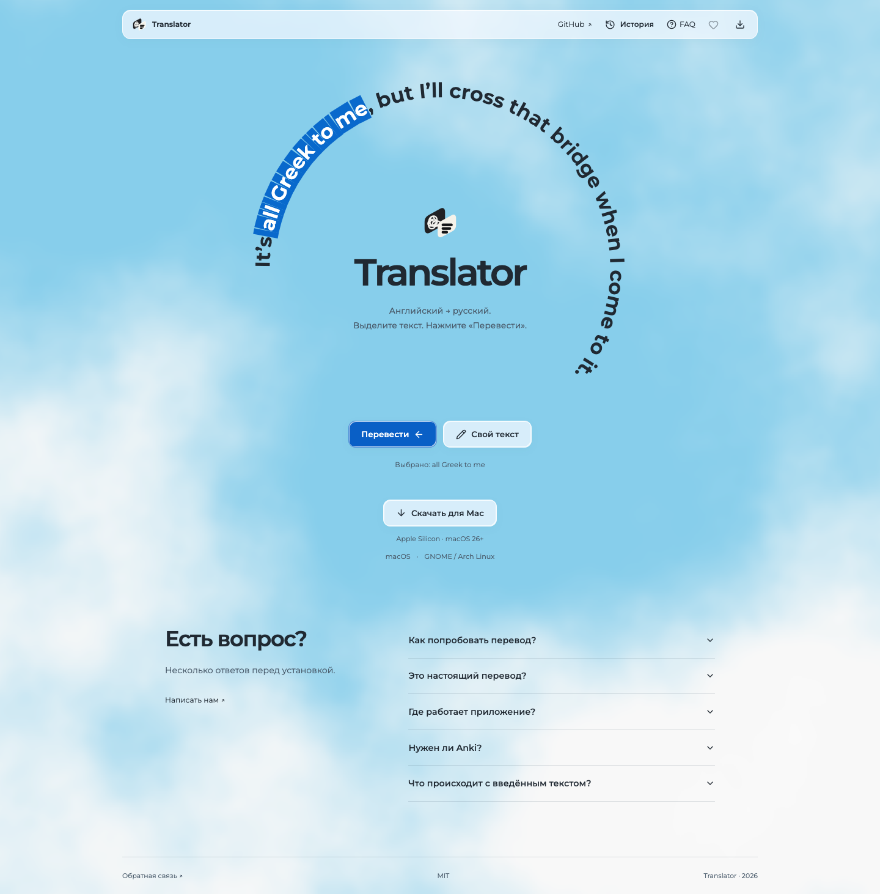
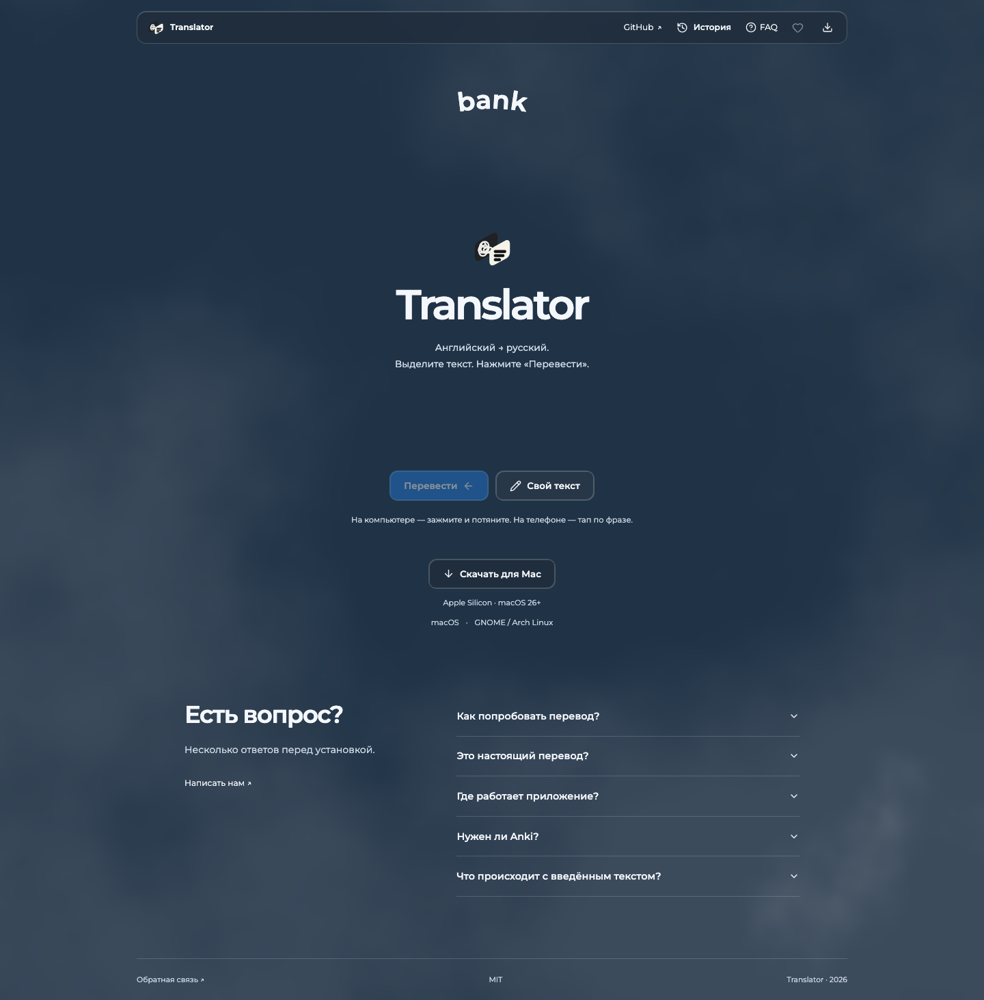
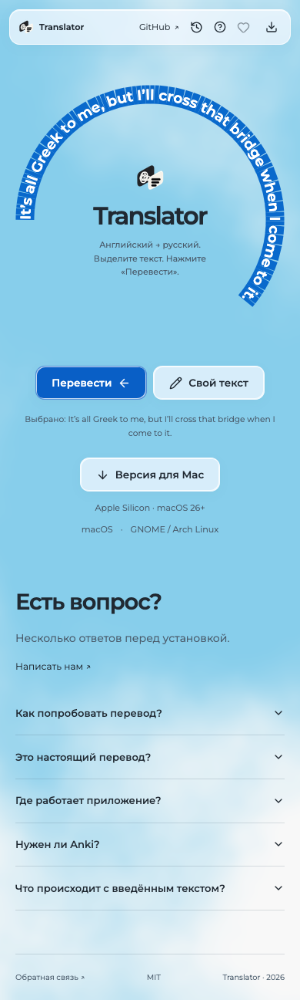

# Онлайн-демо — журнал

## 13.10.2026 — D01/D02: исследование и контракт

- Роль: Root, Codex; native ID `01a1030e-0fcc-7430-8c9d-070c3f569b23`.
- cwd: `/Users/den/Documents/dev/selection_translator_anki`; branch `mac`; base/HEAD `9ccf0ad0c3536e18a77f53fe488341d55dc4b08d`.
- Owned paths этого этапа: `docs/demo/RESEARCH.md`, `docs/demo/EPIC-05-BROWSER-DEMO.md`, `docs/demo/PROGRESS.md`; датированные перекрёстные ссылки в presentation epic/progress.
- Прежние задачи прекращены по steering пользователя; текущие чужие design drafts, удалённый site video и `.codex/` не редактировались.
- Прочитаны context-continuity, preserve-project-design, project continuation capsule, исторический DB checkpoint. Данные истории проверены по текущим site, Apple provider, IPC server и translation pipeline.
- Шаблоны проверены по README, GitHub trees и actual LICENSE. AstroWind MIT; Astroship actual GPL v3 расходится с README GPL-2.0; Cruip README содержит GPL/дополнительные ограничения. Код/зависимости шаблонов не импортировались.
- Проверены официальные API/docs noVNC, Guacamole, Appetize, BrowserStack, AWS EC2 Mac и macOS Tahoe SLA. npm metadata noVNC: `1.7.0`, MPL-2.0. Actual native host/client compatibility не проверена.
- `forge-access remote` подтвердил HTTPS origin `gorodtx/selection_translator_anki.git`; `forge-access auth github` — аккаунт `gorodtx`, HTTP200. Это API-account evidence, не push auth.
- Пользователю отправлены отдельные вопросы о формате демо и наличии Mac-хоста. Ответы пока отсутствуют; настоящий macOS stream сохранён как исходный запрос.

| Уровень | Результат | Evidence / граница |
| --- | --- | --- |
| Контекст/current source | PASS | branch/log/status; `site/`; SelectionCapture; Apple provider; local IPC; translation pipeline |
| Template/API research | PASS | Точные ссылки, tree SHA и лицензии в RESEARCH.md |
| Визуальная приёмка шаблонов | NOT_DONE | Исходники/документация прочитаны, чужие live pages не принимались как наши UI |
| Решение native/web | NOT_DONE | Ответ пользователя ожидается |
| Live demo source/runtime | NOT_DONE | Страница, broker и выделенный host ещё не созданы |
| Browser/native acceptance | NOT_DONE | Runtime отсутствует; desktop не контролировался |
| Commit/push/CI | NOT_DONE | Этот этап сохранён локально; публикация не заявляется |
| Public deployment | NOT_DONE | URL/host не выбран |

Следующая работа: получить формат/host, затем реализовать D05/D06 в рамках существующего дизайна. Доступ к рабочему Mac посетителям не открывался; платные ресурсы не создавались. Эпик остаётся незавершённым.

Resume:

```sh
cd /Users/den/Documents/dev/selection_translator_anki && codex resume 01a1030e-0fcc-7430-8c9d-070c3f569b23
```

Не запускать этот native ID второй раз, пока текущая сессия работает. При продолжении сначала сверить Git и текущий пользовательский ответ, затем читать только этот журнал и исследование.

## 13.10.2026 — круговая сцена: discovery перед реализацией

Новый визуальный steering записан добавлением в эпик: Montserrat, полукруг/спираль вокруг неизменного центрального пространства, редактируемый текст, native-style popup, Cloudscape, сокращённая menu bar, glass buttons, FAQ и OS-aware download. Страницы пяти 21st references прочитаны; визуальное движение компонентов не принималось по одному описанию. Реальная папка шрифта найдена: `/Users/den/Downloads/Montserrat/`; variable upright/italic и OFL доступны. Production UI/code/assets не менялись.

Отправлены три discovery-вопроса: runtime источников, granularity selection и idle motion. Ответы ожидаются. Новые packages/skills не устанавливались; нужные design skills уже доступны. D03/D05/D06 остаются NOT_DONE. Следующий шаг — закрепить ответы и interaction contract, затем приступать к source implementation.

## 13.10.2026 — v0 source и локальная приёмка

Ответы пользователя получены: реальный серверный backend + Apple-style browser UI, desktop drag/touch tap, статичная дуга, перевод кнопкой. Созданы `web/`, `web_backend/`, `deploy/translator/`; dependency group web и отдельный CI. React/TS strict, Tailwind4/shadcn aliases проверены `npx shadcn@latest info --json`. apple-design установлен: `/Users/den/.agents/skills/apple-design/SKILL.md`, 282 строки; permanent usage rule добавлен в `web/AGENTS.md`. Связь с native app/style/data не менялась.

Collective session `term_818dd9d4-7c17-4282-a7d0-e1e05bb009d9` вернула ACK: Caddy не редактируется параллельно; наш scope — `/opt/translator`, project translator, существующая external network и только новый hostname block. Read-only baseline: Linux, Caddy2.11.6; HTTPS kt/app200; Caddyfile SHA256 `b196a6471adc8ee38261841df8dd7764b3d0726f3b7924a24355250a1393ba02`. Публичная routing configuration на этом checkpoint ещё не менялась.

На сервер впервые загружены три DB assets, все pinned SHA256 совпали. Подготовленный скрипт повторного code deployment выдаёт REUSE для совпадающих файлов. Git/image DB corpus не содержит.

Проверки:

- `uv run --group web ruff check web_backend tests/test_web_backend.py` — PASS.
- `uv run --group web python -m mypy --strict web_backend` — PASS; общий mypy — 110 sources PASS.
- HTTP adapter tests — 6 PASS: validation/isolation, body/chunk limit, concurrency/recovery, provider outage, deadline recovery, bounded rate.
- Полный Python suite в clean checkout — 305 PASS, 3 SKIP, 105.42s. SKIP не считается runtime acceptance.
- `npm run build` — PASS; TypeScript strict; JS ~424KB/~137KB gzip, CSS ~21KB/~5.5KB gzip; Montserrat WOFF2~204KB.
- `npm test -- --maxWorkers=1` — 2 PASS (platform detection, iPad/Android fallback).
- Local Firefox157 headless — drag selection реально выбрало `all Greek to me`; touch selection выбрало всю фразу; 390px без horizontal overflow; FAQ opens; page errors0. Source/local browser acceptance, **не live translation**.
- Первый browser pass выявил touch selection collapse и чёрный кадр после theme change. Исправлены; повторный PASS и light/dark PNG лично просмотрены.
- Impeccable detector: три warning по Montserrat. Шрифт прямо задан пользователем, поэтому не заменялся generic recommendation.





Git checks выполняются в отдельном clean checkout `/Users/den/Documents/dev/translator-browser-checkout`, branch `translator/browser-demo`, base `9ccf0ad`. Причина: shared format check встречает три чужих untracked `design/translator-icon/github/revisions/*/build-svg.py`; эти drafts не изменены и не исключены обходом hooks. В clean checkout штатный format check PASS. Код/БД/история пользователя не сбрасывались.

README session подтвердила отсутствие overlap, canonical repository `gorodtx/selection-translator` и завершила свой Claude PID87530; её native resume сохранён внешним owner journal. Дополнительные агенты не создавались. Собственный localhost preview после проверки остановлен; браузер закрыт.

Остаётся: guarded Caddy change, final Git delivery, real deployed HTTP/DB checks, live browser screenshots, resource measurement и повторная проверка kt/app.

## 13.10.2026 — public runtime и server-only исправление

Production code: `524a7919bca2370a0c166027bea8b99959d7840b`; Docker `translator-demo:524a791`, image ID `sha256:6a7a7cdb6af861f5d4407092fc2698d4e8c008bdb5665f452029f91cbf4dba83`. Source snapshot в `/opt/translator/releases/524a791`. Публичный адрес: https://translator.94.156.237.179.nip.io/ — HTTPS200, certificate verification0. Health — healthy; UID10001, read-only root, DB/model mounts read-only, memory limit536870912bytes. Current cgroup289054720bytes; измеренный peak410075136bytes (~391.1MiB), ниже512MiB.

Google из server container возвращает429. Пользователь уточнил: исправлять только на сервере, не ломая установленное приложение. Добавлен отдельный резерв OPUS-MT int8 в `web_backend/offline.py`; общий pipeline и весь `translate_logic/`, `desktop_app/`, `macos/` относительно базы не изменены. `bank` приходит из shared pipeline со словарными определениями/примерами; фразы — из local model при недоступности Google. Источник есть в API и popup. Качество локальной модели для идиом более буквальное; оно не объявляется идентичным Apple/Google.

Проверка сохранности installed app: `/Applications/Translator.app`, версия0.3.1/build332; `codesign --verify --deep --strict` PASS. Приложение не заменялось, пользовательские grants/история/Anki не менялись. Новый native GUI тест не проводился по просьбе пользователя.

Caddy change выполнен после ACK соседней Collective session, hash guard и backup. Original prefix сохранён байт-в-байт; validate + graceful reload PASS. Before SHA `b196a6471adc8ee38261841df8dd7764b3d0726f3b7924a24355250a1393ba02`; after `52e6b8445082331834ba5c1390946107f34a97c8f48829647bba33b76639e558`. Backup `/opt/translator/backups/Caddyfile.before-translator-790f07c`. Повторные проверки kt/app — HTTPS200, certificate verification0. Ни сеть, ни чужие контейнеры/volumes/SSH/firewall не пересоздавались. Коллеге отправлен outcome; его ACK получен, независимую проверку он не заявлял.

Повторные `prepare-model.sh` и `prepare-db.sh` — REUSE. В проверке ошибочно вызван Bash script через `sh`: началась загрузка собственного `.part`; остановлен только точный curl, partial удалён, существующие pinned DB сохранены. Исправлен executable bit `prepare-db.sh`, затем правильный запуск через shebang подтвердил REUSE всех трёх DB. Source archives и runtime не содержат приватных данных или credentials.

Новые проверки и исправления:

- Initial Docker build FAIL: root `lib/` ignore исключал `web/src/lib`. Scoped exception добавлен; Git archive содержит все четыре модуля; real Linux build PASS.
- Adapter8 tests PASS, включая priority исходного dictionary result и bounded worker после cancellation; ruff/format/mypy111 sources PASS.
- Navigation acceptance выявила перекрытие меню пустой областью SVG. Исправлены z-index и pointer-events; реальная History открывается и содержит bank.
- WOFF2 ранее возвращал octet-stream; теперь actual HTTP200 `font/woff2`. SVG `image/svg+xml`, PNG `image/png`; scripts/styles возвращаются без404.
- Firefox157 и Chromium156.0.8078.4: public phrase/word translation, edit, History, 390px tap,200chars/no overflow, FAQ, light/dark, console/page errors0 — PASS.
- WebKit27.2: тот же public runtime PASS. macOS default Tab policy отличается; отдельно проверены focus/Enter у FAQ. Это headless WebKit, **не physical Safari acceptance**.
- Screenshots лично просмотрены: real local-model result, dark dictionary popup и phone result. Evidence: `evidence/live-firefox/`, `evidence/live-chromium/`, `evidence/live-webkit/`.
- Штатные Git gates сохранены. Swift checks работают последовательно без batch/WMO в проверочном checkout; shipping native code/configuration не менялись. Предыдущая parallel compilation превышала бюджет, поэтому эта concurrency исправлена без пропуска build/tests.
- Собственные browser contexts закрываются finally; localhost preview/backend не остаются работать. Root RSS226464KiB + host25152KiB в последнем измерении; native Translator продолжает работать отдельно. Другие проекты/чужие процессы не останавливали.

Git source delivery dry-run524a791 — PASS; actual push/remote SHA и CI пока ожидаются. Отдельный последующий commit72b09d9 меняет только executable bit deployment script; runtime JS/Python совпадают с production524a791. Финальная приёмка и native resume добавляются после доставки.

## 13.10.2026 — source delivery принят; заключительный checkpoint

Штатный `forge-access` token dry-run + execute завершились PASS: remote `mac` подтвердил `524a7919bca2370a0c166027bea8b99959d7840b`. Реальные CI этой source delivery:

- [Browser demo](https://github.com/gorodtx/selection-translator/actions/runs/38331946133) — SUCCESS: strict frontend build,2 platform tests; backend ruff/mypy и8 adapter tests.
- [macos](https://github.com/gorodtx/selection-translator/actions/runs/38331946162) — SUCCESS: общий pytest307 PASS/3 SKIP; mypy111 sources, native shell/sidecar/Linux parity и app-bundle job. Native/public release tag не публиковался и не заменялся.

Заключительный source snapshot `47ca9d084dc74e6bf93a79a12b3940e2f1cc197d` добавляет executable bit preparation script, расширенные acceptance scripts и округление WebGL размеров вниз. Production image `translator-demo:47ca9d0`, ID `sha256:d1ca9faab275e9f3c5f9a1947cd99be4bd8cb6f9447745f5538313605b881695`; container healthy, UID10001/read-only/512MiB. После новых запросов и real queries во всех DB current429613056bytes, peak429690880bytes (~409.8MiB). Бюджет512MiB соблюдён; это cgroup сервиса, не обещание общего расхода всей операционной системы.

Actual normal-motion browser check впервые показал900432pixels из-за округления. Исправлен floor; local subpath `/preview/` и public URL измерили898531pixels, Montserratloaded=true, staticText=true, Linux link правильный, errors0. В local preview assets доступны и в root, и в subpath; реальный API проверяется на опубликованном root hostname. Own temporary server/browser закрыты. Финальный публичный JSON с actual assets/MIME и successful word/whole-phrase response: `evidence/runtime-public.json`. Backend/native код относительно source524a791 не менялся; source delta47ca9d0 не устанавливает новую Mac-версию.

Роль Root, native ID `01a1030e-0fcc-7430-8c9d-070c3f569b23`; original cwd `/Users/den/Documents/dev/selection_translator_anki`, branch `mac`, base `9ccf0ad0c3536e18a77f53fe488341d55dc4b08d`. Проверочный checkout `/Users/den/Documents/dev/translator-browser-checkout`, branch `translator/browser-demo`; собственные changes/commits переносятся в original через fast-forward, чужие dirty design/video/.codex сохраняются. Не запускать native ID вторым процессом. Точный final documentation HEAD, окончательная remote verification/CI и reconciliation receipt сохраняются после завершения commit в `/Users/den/Documents/dev/translator-evidence/2026-10-12/memory-demo/ROOT-PROGRESS.md`; это внешний checkpoint, чтобы не создавать self-referential commit SHA в документе.

Owned delivery paths: `web/`, `web_backend/`, `deploy/translator/`, `docs/demo/`, `tests/test_web_backend.py`, dependency group/lock, setup.cfg, `.orca-gates.json`, `.github/workflows/{web-demo,macos}.yml`; только собственные dated notes в presentation epic. Root README, design drafts, old site video и peer `.codex/` этой задачей не исправлялись.

Остающиеся отдельные возможности: real donation URL — NOT_DONE (нет адреса, placeholder disabled); хоткеи — отложены пользователем; physical Safari/iPhone и native computer-use — NOT_DONE по выбранному способу приёмки. Они не выдаются за выполненные. Качество fallback для идиом ограничено моделью. Предыдущие README/video/memory tasks не возобновлялись.

Resume после остановки, только когда этот ID больше не работает:

```sh
cd /Users/den/Documents/dev/selection_translator_anki && codex resume 01a1030e-0fcc-7430-8c9d-070c3f569b23
```
